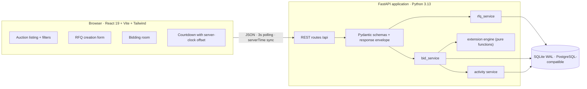
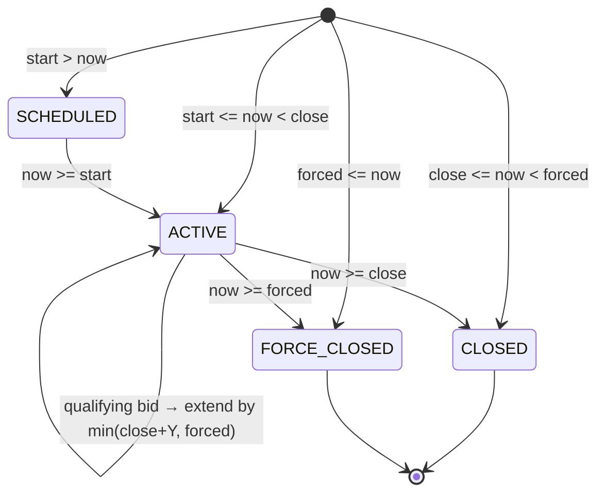

# High-Level Design: British Auction in an RFQ System

## 1. Purpose

This system lets a buyer publish freight RFQs and lets carriers submit quotes in a
reverse auction. When British auction rules are enabled, qualifying bidding activity
close to the deadline extends the close time, while a mandatory forced close time
acts as an absolute ceiling.

The assignment asks for:

- RFQ creation with configurable auction rules
- Automatic time extensions for three trigger types
- A forced close rule that can never be breached
- Auction listing and detail views with live progress
- Ranked supplier quotes and an auditable activity log
- HLD, schema design, backend, and frontend

## 2. Goals and Non-goals

**Goals**

- Correct, deterministic auction mechanics under concurrent bids.
- Transparent ranking (`L1`, `L2`, …) by total landed cost.
- Full audit trail for bids, rank changes, status changes, and extensions.
- Zero-friction local review: one backend command and one frontend command.
- Domain logic isolated from HTTP so it is easy to test and explain.

**Non-goals**

- Authentication, tenancy, and permissions (see ADR-002).
- Payments, document uploads, notifications, or email.
- Multi-currency conversion.
- Multi-region deployment or high-volume messaging.

## 3. Architecture



### 3.1 Components

| Layer | Responsibility |
| :--- | :--- |
| `frontend/src/api.ts` | Typed fetch wrapper, envelope unwrapping, error mapping. |
| `frontend/src/components` | Listing, creation form, bidding room, countdown, leaderboard, activity timeline. |
| `backend/app/routes.py` | HTTP endpoints, dependency injection, response construction. |
| `backend/app/schemas.py` | Pydantic request/response models, camelCase aliases, validation. |
| `backend/app/services/extension.py` | Pure ranking and trigger evaluation; no database access. |
| `backend/app/services/rfq_service.py` | RFQ creation, status resolution, reads. |
| `backend/app/services/bid_service.py` | Transactional bid submission, rank recalculation, extension application. |
| `backend/app/services/activity.py` | Immutable audit entries. |
| `backend/app/models.py` | SQLAlchemy 2.0 models and constraints. |
| `backend/app/db.py` | Engine, SQLite pragmas, `BEGIN IMMEDIATE` transaction hook. |

### 3.2 Layering rule

Pure domain functions know nothing about FastAPI or SQLAlchemy. Services own the
unit of work and commit once per use case. Routes only translate HTTP <-> services.
This makes the extension rules testable with plain values.

## 4. Domain Model

- **RFQ** — lane, pickup date, bid window (`start`, `close`), hard ceiling
  (`forced close`), auction configuration (`X`, `Y`, trigger), status.
- **Quote** — carrier, three charge components, computed total, transit time,
  validity date, current rank, submission timestamp.
- **ActivityLog** — append-only event with type, human-readable description, and
  JSON metadata.

Total landed cost:

```
total = freight_charges + origin_charges + destination_charges   (2dp, half-up)
```

Ranking:

```
order by total asc, submitted_at asc, id asc   →  L1, L2, L3, ...
```

An earlier equal-price bid keeps the better rank. `id` is the final deterministic
tie-break so ranks never collide.

Each quote submission is an independent ranked bid. If a supplier lowers their price
several times, each submission appears in the leaderboard and in the activity log;
the supplier’s best-ranked bid is their effective position in the auction.

## 5. Lifecycle



Status is derived from timestamps whenever an RFQ is read or bid on
(`resolve_status_from_times`). Transitions are persisted and logged. Terminal statuses
never regress (ADR-007).

## 6. Bid Submission Flow

```mermaid
sequenceDiagram
    participant UI as Supplier UI
    participant API as FastAPI
    participant DB as Database
    UI->>API: POST /api/rfqs/{id}/quotes
    API->>DB: BEGIN IMMEDIATE; SELECT rfq FOR UPDATE
    API->>API: Capture now (inside the lock)
    API->>DB: Refresh status; reject unless ACTIVE
    API->>API: Reject expired quote validity
    API->>DB: Read existing quotes
    API->>API: Compute previous ranks and L1
    API->>DB: INSERT quote; recompute and update all ranks
    API->>API: Evaluate window and trigger
    alt trigger fired and close can move
        API->>DB: UPDATE bid_close_time = min(close + Y, forced)
        API->>DB: INSERT AUCTION_EXTENDED (+ BID_SUBMITTED, RANK_CHANGED)
    else trigger fired but close already at forced
        API->>DB: INSERT EXTENSION_BLOCKED
    else no trigger
        API->>DB: INSERT BID_SUBMITTED (+ RANK_CHANGED if applicable)
    end
    API->>DB: COMMIT
    API-->>UI: 201 quote, rank, updated RFQ, extension outcome
```

### 6.1 Extension algorithm

Given a bid at `T_bid`, current close `T_close`, forced close `T_forced`,
window `X`, extension `Y`, and trigger `R`:

1. If the RFQ is not `ACTIVE`, reject with a lifecycle error.
2. If `validity_date <= T_bid`, reject with `INVALID_QUOTE_VALIDITY`.
3. Compute the new quote total and insert it.
4. Recompute ranks from every quote.
5. If British auction rules are disabled, stop without extending.
6. If `T_bid ∉ [T_close - X, T_close]`, stop without extending.
7. Evaluate `R` against the pre-bid and post-bid rank maps:
   - `ANY_BID` → always true.
   - `ANY_RANK_CHANGE` → true when a supplier that existed before the bid changed
     rank. A new supplier joining alone is not a change.
   - `L1_RANK_CHANGE` → true when the identity of `L1` changed. The first bid counts
     as an L1 change.
8. If the trigger did not fire, stop.
9. `T_close' = min(T_close + Y, T_forced)`.
10. If `T_close' == T_close`, the ceiling is already reached: log
    `EXTENSION_BLOCKED`, leave the close time unchanged.
11. Otherwise update the close time and log `AUCTION_EXTENDED` with the previous and
    new close times, the trigger, the reason, and whether the value was clamped.

## 7. Concurrency and Integrity

- **Write serialisation:** every transaction starts with `BEGIN IMMEDIATE`
  (SQLite). This acquires the write lock before reads, so two bids cannot observe the
  same close time and both extend it.
- **Timestamp inside the lock:** the bid timestamp is taken after the lock is held,
  which keeps tie-breaking and the activity feed in true serialised order.
- **One transaction per bid:** insert, rank recalculation, extension, and audit logs
  commit together. A failure rolls back the whole bid.
- **Ceiling invariants:**
  - API validation requires `forced > close > start` at creation.
  - The extension formula clamps at `forced`.
  - A database check constraint allows `forced >= close` (equality is reachable at
    the ceiling) and a second constraint requires `close > start`.
  - Bids at or after `forced` are rejected and the status becomes `FORCE_CLOSED`.
- **Dense ranks:** every submission rewrites all ranks from a single ordered list,
  so ranks are always `1..n` with no gaps or duplicates.
- **PostgreSQL path:** the same service uses `SELECT ... FOR UPDATE` on the RFQ row.

## 8. API

All endpoints return a consistent envelope:

```json
{
  "success": true,
  "data": { },
  "serverTime": "2026-11-14T10:15:30.123Z"
}
```

Errors:

```json
{
  "success": false,
  "error": {
    "code": "AUCTION_CLOSED",
    "message": "Bidding is closed for this RFQ."
  },
  "serverTime": "2026-11-14T10:15:30.123Z"
}
```

| Method | Path | Purpose |
| :--- | :--- | :--- |
| `GET` | `/api/health` | Liveness probe. |
| `POST` | `/api/rfqs` | Create an RFQ with auction configuration. |
| `GET` | `/api/rfqs` | List RFQs with status, lowest bid, and close times. |
| `GET` | `/api/rfqs/{id}` | RFQ detail, ranked quotes, and activity feed. |
| `GET` | `/api/rfqs/{id}/activity` | Full activity timeline. |
| `POST` | `/api/rfqs/{id}/quotes` | Submit a quote and evaluate extensions. |

### Error codes

| Code | HTTP | When |
| :--- | :--- | :--- |
| `VALIDATION_ERROR` | 422 | Invalid payload or schedule ordering. |
| `DUPLICATE_REFERENCE` | 409 | RFQ reference already exists. |
| `RFQ_NOT_FOUND` | 404 | Unknown RFQ id. |
| `BIDDING_NOT_OPEN` | 409 | Bid before the start time. |
| `AUCTION_CLOSED` | 409 | Bid at or after the close time. |
| `AUCTION_FORCE_CLOSED` | 409 | Bid at or after the forced close. |
| `INVALID_QUOTE_VALIDITY` | 422 | Quote validity is not in the future. |
| `CONFLICT` | 409 | Database uniqueness or constraint conflict. |

## 9. Frontend

- **Listing:** filterable cards (all/active/scheduled/closed) showing reference,
  title, lowest bid, countdown, quote count, trigger configuration, and forced close.
- **Creation:** buyer-only form with inline ordering validation; defaults are
  prefilled so a reviewer can create a live auction in seconds.
- **Bidding room:** large countdown, configuration chips, forced close card,
  ranked leaderboard with charge breakdown, supplier quote form, and activity
  timeline. The countdown turns amber inside the trigger window.
- **Clock discipline:** `serverTime` from every response updates a drift offset;
  countdowns use server time, not the local clock.
- **Refresh:** detail polls every 3s, listing every 5s. The submit response already
  returns the new close time, so the winning bidder sees the extension immediately.
- **Roles:** buyer/supplier switch is stored locally; supplier name is prefilled
  from local storage (ADR-002).

## 10. Seed Data

On first startup with an empty database, the backend seeds four RFQs:

1. `RFQ-2026-001` — active, three ranked quotes, `ANY_RANK_CHANGE` trigger.
2. `RFQ-2026-002` — active and extended twice by in-window bids (`ANY_BID`).
3. `RFQ-2026-003` — scheduled in the future, no bids.
4. `RFQ-2026-004` — closed with three ranked quotes.

Delete `backend/auction.db` (and its `-wal`/`-shm` files) to reseed.

## 11. Configuration

| Variable | Default | Purpose |
| :--- | :--- | :--- |
| `DATABASE_URL` | `sqlite:///<backend>/auction.db` | SQLAlchemy URL; point at PostgreSQL to switch. |
| `CORS_ORIGINS` | `http://localhost:5173,http://127.0.0.1:5173` | Allowed browser origins. |
| `SEED_DEMO_DATA` | `1` | Seed example auctions when the database is empty. |
| `SQL_ECHO` | `0` | Log SQL statements. |

## 12. Testing Strategy

- **Unit tests** for ranking order, tie-breaking, window boundaries, trigger
  semantics, and ceiling clamps.
- **Integration tests** through the ASGI app for creation, validation, ranking,
  every trigger type, lifecycle guards, and audit content.
- **Concurrency tests** start parallel final-window bids and assert: all bids stored,
  dense unique ranks, close time never above forced close, exactly one blocked
  extension at the ceiling, and monotonic extension timestamps.

Run: `cd backend && .venv\Scripts\python -m pytest -q`

## 13. Trade-offs and Future Work

| Current | Trade-off | Next step |
| :--- | :--- | :--- |
| Polling every 3s | Up to 3s of staleness | SSE with in-process/Redis pub/sub |
| SQLite write serialisation | Bounded write throughput | PostgreSQL row locks per RFQ |
| Client-side roles | No protection | JWT + supplier ownership + tenancy |
| `create_all` schema | No migration history | Alembic |
| Status on read | No proactive notifications | Scheduled worker for transitions |
| USD formatting | Single currency assumption | Currency field + normalisation |
