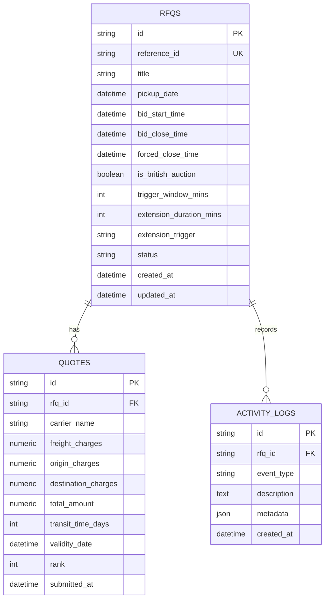

# Database Schema

The schema is defined with SQLAlchemy 2.0 declarative models in
`backend/app/models.py`. It runs unchanged on SQLite (default) and PostgreSQL.

## 1. Entity Relationship Diagram



## 2. `rfqs`

| Column | Type | Null | Notes |
| :--- | :--- | :--- | :--- |
| `id` | `VARCHAR(36)` | no | UUID primary key. |
| `reference_id` | `VARCHAR(50)` | no | Human-readable unique reference (`RFQ-2026-001`). |
| `title` | `VARCHAR(255)` | no | Lane / service description. |
| `pickup_date` | `DATETIME` | no | Service or pickup date (UTC). |
| `bid_start_time` | `DATETIME` | no | Bidding opens. |
| `bid_close_time` | `DATETIME` | no | Current scheduled close; moves on extension. |
| `forced_close_time` | `DATETIME` | no | Absolute ceiling; never changes. |
| `is_british_auction` | `BOOLEAN` | no | When false, close time never extends. |
| `trigger_window_mins` | `INTEGER` | no | `X`, the monitored window before close. |
| `extension_duration_mins` | `INTEGER` | no | `Y`, minutes added per extension. |
| `extension_trigger` | `VARCHAR(30)` | no | `ANY_BID`, `ANY_RANK_CHANGE`, `L1_RANK_CHANGE`. |
| `status` | `VARCHAR(20)` | no | `SCHEDULED`, `ACTIVE`, `CLOSED`, `FORCE_CLOSED`. |
| `created_at` | `DATETIME` | no | Insert timestamp (UTC). |
| `updated_at` | `DATETIME` | no | Last mutation (UTC). |

### Constraints

| Name | Rule | Why |
| :--- | :--- | :--- |
| `ck_rfq_forced_after_close` | `forced_close_time >= bid_close_time` | Extensions clamp to the ceiling, so equality must be representable. Creation is stricter (see below). |
| `ck_rfq_close_after_start` | `bid_close_time > bid_start_time` | Prevents zero/negative bid windows. |
| `ck_rfq_positive_trigger_window` | `trigger_window_mins > 0` | Window must be meaningful. |
| `ck_rfq_positive_extension` | `extension_duration_mins > 0` | An extension must add time. |
| unique | `reference_id` | Stable external identifier. |

**Creation-time validation is stricter than the database check:** the API requires
`forced > close > start`. Equality is only reachable later, when an extension is
clamped against `forced`. The constraint intentionally permits that state.

### Indexes

| Index | Columns | Serves |
| :--- | :--- | :--- |
| `ix_rfqs_status_close` | `status, bid_close_time` | Status filters and a future scheduler scanning soon-to-close auctions. |
| unique `reference_id` | `reference_id` | Duplicate detection and lookup by external reference. |

## 3. `quotes`

| Column | Type | Null | Notes |
| :--- | :--- | :--- | :--- |
| `id` | `VARCHAR(36)` | no | UUID primary key. |
| `rfq_id` | `VARCHAR(36)` | no | FK to `rfqs.id`, `ON DELETE CASCADE`. |
| `carrier_name` | `VARCHAR(100)` | no | Supplier identity for this quote. |
| `freight_charges` | `NUMERIC(12,2)` | no | Base ocean/air/road freight. |
| `origin_charges` | `NUMERIC(12,2)` | no | Origin handling, documentation, customs. |
| `destination_charges` | `NUMERIC(12,2)` | no | Destination handling, delivery, customs. |
| `total_amount` | `NUMERIC(12,2)` | no | Server-computed sum; never accepted from clients. |
| `transit_time_days` | `INTEGER` | no | Quoted transit duration. |
| `validity_date` | `DATETIME` | no | Quote expiry (UTC); must be after submission. |
| `rank` | `INTEGER` | yes | Current `L` rank; rewritten on every bid in the RFQ. |
| `submitted_at` | `DATETIME` | no | Server timestamp taken inside the write transaction. |

### Constraints

| Name | Rule |
| :--- | :--- |
| `ck_quote_freight_non_negative` | `freight_charges >= 0` |
| `ck_quote_origin_non_negative` | `origin_charges >= 0` |
| `ck_quote_destination_non_negative` | `destination_charges >= 0` |
| `ck_quote_transit_non_negative` | `transit_time_days >= 0` |
| FK cascade | Deleting an RFQ deletes its quotes. |

### Indexes

| Index | Columns | Serves |
| :--- | :--- | :--- |
| `ix_quotes_rfq_total` | `rfq_id, total_amount, submitted_at` | Rebuilding the ordered quote list and finding the lowest bid. |
| `ix_quotes_rfq_rank` | `rfq_id, rank` | Leaderboard reads ordered by rank. |

### Ranking invariant

```
FOR every rfq:
  ranks form exactly {1, 2, ..., n}
  ordering key = (total_amount ASC, submitted_at ASC, id ASC)
```

Ranks are recomputed from the full quote set inside the same transaction that
inserts a quote, so they cannot drift.

## 4. `activity_logs`

| Column | Type | Null | Notes |
| :--- | :--- | :--- | :--- |
| `id` | `VARCHAR(36)` | no | UUID primary key. |
| `rfq_id` | `VARCHAR(36)` | no | FK to `rfqs.id`, `ON DELETE CASCADE`. |
| `event_type` | `VARCHAR(50)` | no | See event types below. |
| `description` | `TEXT` | no | Human-readable audit sentence. |
| `metadata` | `JSON` | yes | Structured details (`previousCloseTime`, `newCloseTime`, `trigger`, `reason`, ranks, amounts). |
| `created_at` | `DATETIME` | no | Event timestamp (UTC, microsecond precision). |

### Event types

| Type | Meaning |
| :--- | :--- |
| `RFQ_CREATED` | RFQ and its configuration were created. |
| `BID_SUBMITTED` | A quote was accepted; amount, carrier, and rank recorded. |
| `RANK_CHANGED` | One or more existing suppliers changed rank. |
| `AUCTION_EXTENDED` | Close time moved; old/new close and trigger reason recorded. |
| `EXTENSION_BLOCKED` | Trigger fired but the close time was already at the forced ceiling. |
| `STATUS_CHANGED` | Lifecycle transition (`SCHEDULED/ACTIVE/CLOSED/FORCE_CLOSED`). |

### Indexes

| Index | Columns | Serves |
| :--- | :--- | :--- |
| `ix_activity_logs_rfq_created` | `rfq_id, created_at` | Detail-page timeline (newest first) and per-RFQ audit queries. |
| `ix_activity_logs_event_type` | `event_type` | Operational reporting, e.g. counting extensions or blocked triggers. |

The table is append-only. No application code updates or deletes log rows; deletion
happens only through the RFQ cascade.

## 5. Enumerations

| Domain | Values |
| :--- | :--- |
| Auction status | `SCHEDULED`, `ACTIVE`, `CLOSED`, `FORCE_CLOSED` |
| Extension trigger | `ANY_BID`, `ANY_RANK_CHANGE`, `L1_RANK_CHANGE` |
| Activity event | `RFQ_CREATED`, `BID_SUBMITTED`, `RANK_CHANGED`, `AUCTION_EXTENDED`, `EXTENSION_BLOCKED`, `STATUS_CHANGED` |

Values are stored as strings for portability and readable SQL. Pydantic restricts
the trigger and status values at the API boundary.

## 6. Business Invariants Enforced by Code

1. `total_amount = freight + origin + destination`, rounded half-up to 2 decimals.
2. A quote is only accepted while `start <= now < close` and `now < forced`.
3. `validity_date > submitted_at`.
4. `bid_close_time` moves only by `min(close + Y, forced)` and never decreases.
5. Every bid, rank change, extension, blocked extension, and status transition
   writes an activity row in the same transaction.
6. `submitted_at` is captured after the database write lock is acquired.

## 7. Time and Money Representation

- Timestamps are stored as UTC without timezone metadata (SQLite-compatible) and
  serialised as ISO-8601 with a trailing `Z` and millisecond precision.
- Money is `NUMERIC(12,2)` / Python `Decimal` and is serialised as a string to
  preserve precision.
- Request payloads accept ISO-8601 with an offset; the API converts to UTC.

## 8. Access Patterns

| Query | Path |
| :--- | :--- |
| Listing with lowest bid | `rfqs` ordered by `created_at DESC`, quotes eagerly loaded. |
| Detail | `rfqs` by id with quotes and logs eagerly loaded. |
| Leaderboard | quotes by `rfq_id`, sorted by rank/total. |
| Activity page | logs by `rfq_id` ordered by `created_at DESC` (first 100 in detail). |
| Bid mutation | quotes by `rfq_id`, then rank rewrite and log insert in one transaction. |

## 9. Migration Path

The demo creates tables with SQLAlchemy metadata. When the schema starts to evolve:

1. Add Alembic and initialise it against the current models.
2. Generate an initial revision reflecting the tables above.
3. Replace startup `create_all` with `alembic upgrade head` in deployment.
4. For PostgreSQL, switch `DATABASE_URL`; `NUMERIC`, `JSON`, and cascading foreign
   keys map directly.
